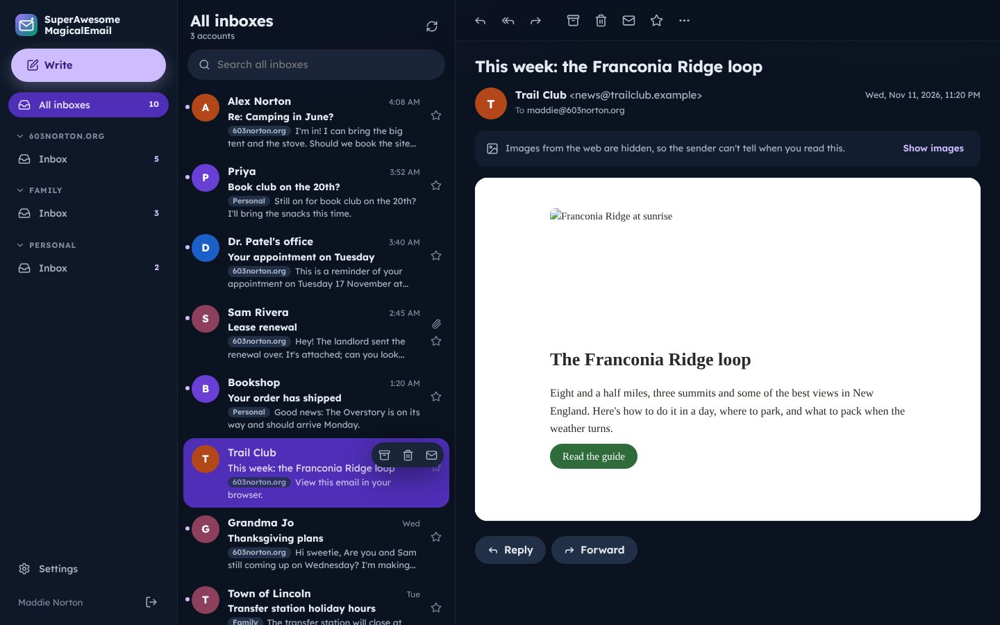
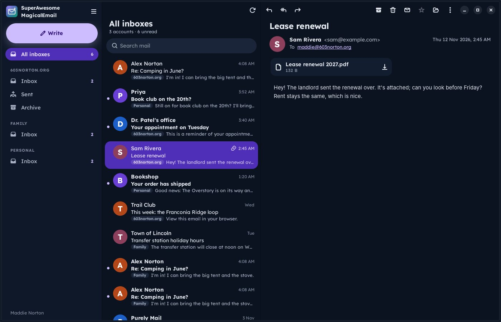
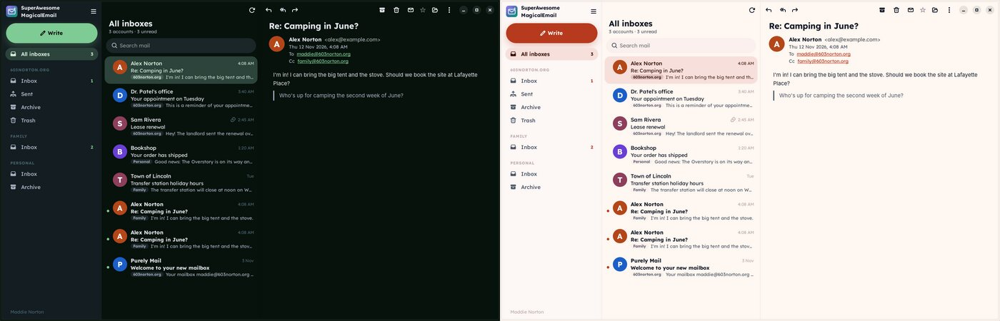
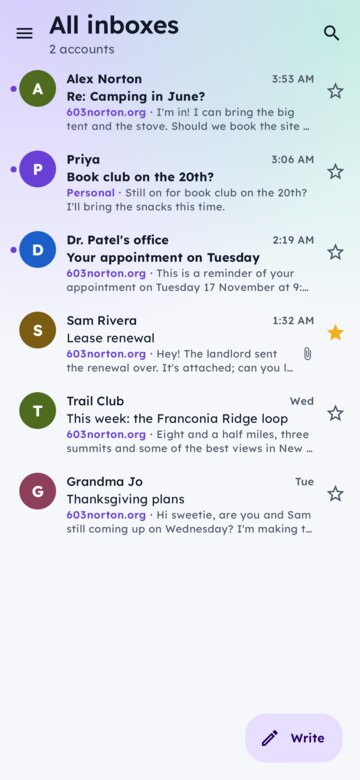
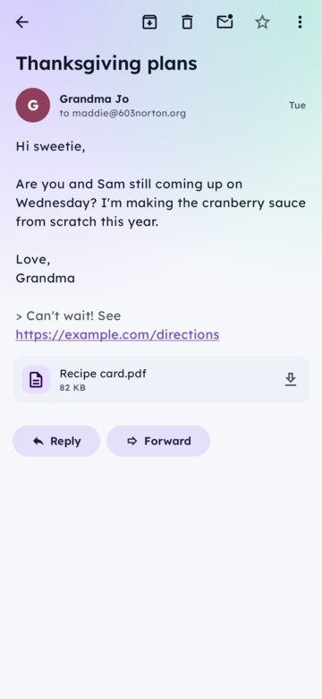
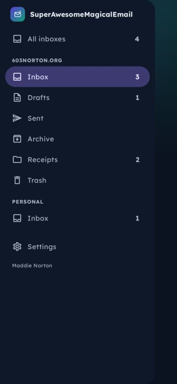
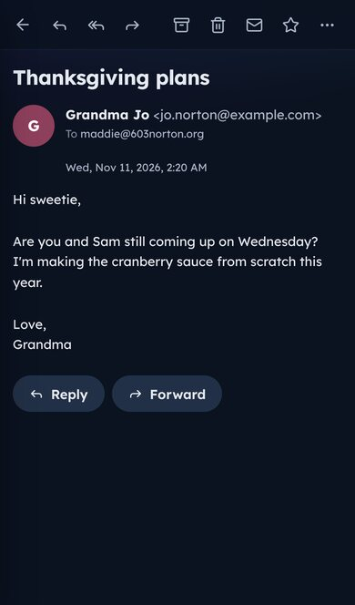

# SuperAwesomeMagicalEmail

Webmail for a family's mailboxes, signed in with **Authentik**. You keep the mailboxes where they
are (made for **PurelyMail**, and any other service with IMAP and SMTP). This server signs in to
them for you, so the people you give a mailbox to only ever sign in with Authentik. They never see
its password.

- **For the people reading mail:** go to `mail.603norton.org`, **Sign in with Authentik**, and the
  mailboxes you've been given are there: every inbox together, each one's folders, search, reading,
  writing, replying and forwarding, attachments, drafts, archive, junk, stars. If the admin allows
  it, add your own accounts too (Gmail, iCloud, Fastmail, Yahoo or any IMAP service).
- **For the admin:** make a mailbox at PurelyMail, add its address and password here once (they're
  checked, then kept encrypted), and give it to one person or several. People can be added before
  they've ever signed in; their mailboxes are waiting for them on their first Authentik sign-in.

This repository holds:

- **The server** (`server/`, with the **web app** in `web/`): Kotlin and Ktor, SQLite, IMAP and SMTP
  through Jakarta Mail. One container for Podman (or Docker).
- **SuperAwesomeMagicalEmail for Android** (`android/`): enter the server's address, sign in with
  Authentik in the browser, and your mail is there, with notifications for new mail (Archive and
  Mark read on the notification). Android 8.0 and later.
- **SuperAwesomeMagicalEmail for Linux** (`desktop/`): a native GTK 4 app for Ubuntu 24.04+, Fedora
  40+ and **SuperAwesomeMagicalLinux**, where it follows the desktop's own colours, tells you about
  new mail through the shell's notifications, and is your `mailto:` handler. See
  [desktop/README.md](desktop/README.md).
- **shared** (`shared/`): the API's types, used by the server and the Android app.

All of them have the family's look: Lexend, rounded pills and cards over a soft glow, and the
themes Aurora (purple and green, the default), Violet, Ocean and Ember, light or dark.

## In action



| The Linux app | Following SuperAwesomeMagicalLinux's colours, as they change |
| --- | --- |
|  |  |

The Android app (the inbox, a message, the folders in the dark) and the web app on a phone:

<p>
  
  
  
  
</p>

## Running the server

The image is `ghcr.io/603madison/superawesomemagicalemail` (amd64 and arm64). Everything it keeps
is in `/data`: the database (`same.db`), the key that encrypts mailbox passwords (`secret.key`) and
files being attached. **Back up `/data` as a whole**: the database's mailbox passwords can't be read
without its key.

### With Podman (a Quadlet)

[`deploy/superawesomemagicalemail.container`](deploy/superawesomemagicalemail.container) runs it as
a systemd service, listening on `127.0.0.1:8095` for your reverse proxy, with
`SAME_PUBLIC_URL=https://mail.603norton.org`:

```bash
mkdir -p ~/.config/containers/systemd && cp deploy/superawesomemagicalemail.container ~/.config/containers/systemd/
```

```bash
systemctl --user daemon-reload && systemctl --user start superawesomemagicalemail
```

```bash
loginctl enable-linger $USER
```

(The last keeps it running while you're logged out.) For a system-wide service, copy it to
`/etc/containers/systemd/` and use `sudo systemctl` instead. With `AutoUpdate=registry`,
`podman auto-update` (or its timer) picks up new releases.

Or with Compose ([`deploy/compose.yaml`](deploy/compose.yaml)): `podman compose up -d`.

### The first sign-in

The first start makes a **break-glass admin** (`admin`, with a password it logs once, or the one in
`SAME_ADMIN_PASSWORD`). It's for setting up and for when Authentik is down:

```bash
journalctl --user -u superawesomemagicalemail | grep -A3 "break-glass"
```

Lost it? `podman exec superawesomemagicalemail /opt/same/bin/same-server reset-admin-password`
sets a new one (and prints it).

### Behind a reverse proxy

Point `mail.603norton.org` at `127.0.0.1:8095` and keep `SAME_TRUST_PROXY=true` (the server then
believes the proxy's `X-Forwarded-*` headers). With Caddy:

```
mail.603norton.org {
    reverse_proxy 127.0.0.1:8095
}
```

Behind Cloudflare, also set `SAME_CLIENT_IP_HEADER=CF-Connecting-IP`.

## Setting up Authentik

1. In Authentik, **Applications › Providers › Create › OAuth2/OpenID Provider**: client type
   *Confidential*, redirect URI `https://mail.603norton.org/api/auth/oidc/callback` (the admin page
   shows it, with a Copy button), and the default `openid`, `profile` and `email` scopes.
2. **Applications › Applications › Create**, using that provider. Its slug goes in the issuer:
   `https://auth.example.com/application/o/<slug>/`.
3. On this server's **Admin** page (signed in as the break-glass admin), under single sign-on, fill
   in the issuer, client ID and client secret, then **Test**. Optionally:
   - **Group allowed to sign in**: an Authentik group (only its members get in).
   - **Admin group**: an Authentik group whose members are admins here.
   - **Make an account on first sign-in**: off means only people you've added can sign in.
   - **People can sign in with a password**: off once Authentik works, so everyone signs in
     through it (the break-glass admin always can).

The same settings can be given as environment variables (`SAME_OIDC_ISSUER`,
`SAME_OIDC_CLIENT_ID`, `SAME_OIDC_CLIENT_SECRET`, …, below), which then win over the admin page.
Keep the secret in an `EnvironmentFile` only you can read.

## Giving people their mail (the PurelyMail way)

1. **At PurelyMail**, make the mailbox (say `family@603norton.org`) and give it a password (or make
   an app password for it).
2. **Here, Admin › Mailboxes › Add a mailbox › PurelyMail**: the address and that password. The
   server signs in to check it (IMAP `imap.purelymail.com:993` and SMTP `smtp.purelymail.com:465`,
   both TLS), then keeps the password encrypted. PurelyMail doesn't keep copies of mail sent over
   SMTP, so the server saves them in Sent itself.
3. **Give it to people**: tick who reads it (one person, or several for a shared family mailbox).
   Each person who has it can set their own signature for it.

**People who haven't signed in yet:** under **People › Add a person**, add them by their Authentik
username (or email address) and give them their mailboxes. They show as *Waiting for first sign-in*.
The first time they sign in with Authentik, that account becomes theirs (matched by username or
email, then tied to their Authentik identity for good). Until then, anyone whose Authentik username
or email matches could claim it, so in Authentik's **System › Settings**, don't let users change
their own username or email.

**Their own accounts:** with *People can add their own mail accounts* on (Admin, or
`SAME_PERSONAL_ACCOUNTS`), people add Gmail, iCloud, Fastmail, Yahoo or any IMAP account in
**Settings**, with an app password (the form says where to make one). Microsoft accounts
(Outlook.com, Microsoft 365) aren't supported: they no longer allow password sign-in for IMAP.

## The apps

- **Android**: install `SuperAwesomeMagicalEmail-vX.Y.Z.apk` from the releases. Enter
  `mail.603norton.org`, sign in with Authentik in the browser, and you're in. New mail is checked
  about every 15 minutes in the background (Android's limit for apps without their own push
  service).
- **Linux**: the `.deb` (Ubuntu 24.04+) or `.rpm` (Fedora 40+) from the releases. On
  SuperAwesomeMagicalLinux: `rpm-ostree install ./SuperAwesomeMagicalEmail-Desktop-vX.Y.Z-x86_64.rpm`,
  then restart. See [desktop/README.md](desktop/README.md).

Both sign in the same way: the app opens the server's `/connect-app` page in the browser, where
you sign in with Authentik and approve it; the browser hands the app a one-time code
(`samemail://signed-in`), which the app swaps (with a secret only it has: PKCE) for its own
sign-in. **Settings › Signed in on** in the web app lists every device, and signs any of them out.

## Settings

| Variable | Default | |
| --- | --- | --- |
| `SAME_PUBLIC_URL` | (from the request) | The address people use, like `https://mail.603norton.org`. Needed behind a proxy for single sign-on. |
| `SAME_TRUST_PROXY` | `false` | Believe the reverse proxy's `X-Forwarded-*` headers. |
| `SAME_PROXIES` | `1` | How many proxies are in front (to find the visitor's address). |
| `SAME_CLIENT_IP_HEADER` | | A header holding the visitor's address, like `CF-Connecting-IP`. |
| `SAME_ADMIN_USERNAME` | `admin` | The break-glass admin's username. |
| `SAME_ADMIN_PASSWORD` | (generated, logged once) | Its first password. |
| `SAME_OIDC_ISSUER`, `SAME_OIDC_CLIENT_ID`, `SAME_OIDC_CLIENT_SECRET` | | Authentik, instead of the admin page. |
| `SAME_OIDC_USER_GROUP`, `SAME_OIDC_ADMIN_GROUP` | | Who may sign in, and who's an admin. |
| `SAME_OIDC_BUTTON_LABEL` | `Sign in with Authentik` | The sign-in button's words. |
| `SAME_OIDC_SCOPES` | `openid profile email` | |
| `SAME_LOCAL_LOGIN` | `true` | Passwords as well as Authentik. |
| `SAME_PERSONAL_ACCOUNTS` | `true` | People can add their own mail accounts. |
| `SAME_MAX_MESSAGE_MB` | `25` | The largest message (with attachments) that can be sent. |
| `SAME_ALLOW_PRIVATE_MAIL_HOSTS` | `false` | Allow mail servers on private addresses (a mail server on your own network). |
| `SAME_DATA_DIR`, `SAME_HOST`, `SAME_PORT` | `/data`, `0.0.0.0`, `8080` | |
| `TZ` | `UTC` | The server's time zone. |

## Privacy and safety

- Mailbox passwords are encrypted (AES-GCM) with the key in `/data/secret.key`; the API never hands
  them back, not even to admins.
- HTML mail is cleaned on the server (no scripts, forms or tracking pixels) and shown in a sandboxed
  frame with no scripts. Images from the web load only when you ask, and then through the server,
  so senders don't see your address.
- The server only connects to mail servers on the public internet (unless
  `SAME_ALLOW_PRIVATE_MAIL_HOSTS`), so a mailbox's settings can't be used to reach your network.
- Sign-ins are stored hashed; the web app's cookie is `HttpOnly` and `SameSite`, with a header
  check on every change. Each app has its own sign-in, listed and revocable in Settings.

## Building

The server and Android app use Gradle (JDK 21); the web app Node 22; the Linux app Rust (see its
README).

```bash
cd web && npm ci && npm run build && cd ..
```

```bash
./gradlew :server:test :server:installDist
```

```bash
SAME_DATA_DIR=./data server/build/install/same-server/bin/same-server
```

For the web app with live reloading, run the server as above and `npm run dev` in `web/` (it
proxies `/api` to port 8080). The Android app: `./gradlew :android:assembleDebug`, and
`:android:testDebugUnitTest` for its tests (including an end-to-end run against a real server and
mail server). `SAME_SERVER_ONLY=1` leaves the Android app out of the build.

The container: `podman build -t superawesomemagicalemail -f Containerfile .`

Releases (the signed APK, the Linux packages and the image) are made by the **Release** workflow;
see [CLAUDE.md](CLAUDE.md).

## License

GPL-3.0 ([LICENSE](LICENSE)). The Lexend typeface is under the SIL Open Font License 1.1
([licenses/Lexend-OFL.txt](licenses/Lexend-OFL.txt)).
